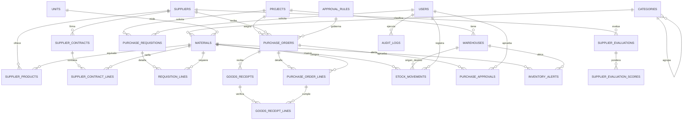

# Gestión de inventarios — Constructora Del Ralle S.A.

**Quiz 2 · Borrador de informe para completar y exportar a PDF**

**Equipo:** completar nombres e integrantes  
**Solución elegida:** Opción 2, control de inventario para una empresa de construcción  
**Tecnología:** Node.js, Express, Sequelize y MySQL  

> Los datos y las evaluaciones de proveedores usados en el prototipo son ficticios. Revisar el borrador y completar los datos del equipo antes de entregarlo.

## 1. Problema y solución

Obras, Mantenimiento y Bodega Central compran y consumen materiales en ubicaciones distintas. La falta de un catálogo común y de movimientos trazables facilita compras repetidas, diferencias de inventario y reposiciones tardías. La solución normaliza materiales con códigos internos, registra el saldo por bodega a partir de movimientos, conserva el documento que respalda cada entrada/salida y genera alertas calculadas de reorden. Las órdenes pasan por una regla de cotizaciones y aprobación basada en su monto acumulado por solicitante, obra y categoría.

La API comprueba existencia antes de aceptar salidas o traslados, registra una bitácora y expone consultas de stock, trazabilidad, alertas y posibles OC duplicadas. Las alertas quedan en base de datos; para un uso real se integraría un canal de notificación y autenticación por usuario.

## 2. Modelo entidad-relación

Las 23 entidades son `projects`, `warehouses`, `users`, `suppliers`, `categories`, `units`, `materials`, `supplier_products`, `supplier_contracts`, `supplier_contract_lines`, `purchase_requisitions`, `requisition_lines`, `approval_rules`, `purchase_orders`, `purchase_order_lines`, `goods_receipts`, `goods_receipt_lines`, `stock_movements`, `purchase_approvals`, `inventory_alerts`, `audit_logs`, `supplier_evaluations` y `supplier_evaluation_scores`.

## 3. Parte A — análisis

### A1. Circuito de compra y aprobación

| Etapa | Responsable | Registro/documento | Control |
|---|---|---|---|
| Requisición | Área solicitante / jefatura | Requisición con obra, categoría, artículo normalizado, cantidad, justificación y presupuesto | Validar necesidad, stock disponible y presupuesto del proyecto |
| Cotización y selección | Compras | Cotizaciones comparables y evaluación de proveedores | Comparar especificación equivalente, precio, entrega, calidad y contrato vigente |
| Aprobación | Rol definido por monto acumulado | Decisión y usuario aprobador | Segregación de funciones, cotizaciones mínimas y detección de fraccionamiento |
| Orden de compra | Compras | OC numerada con proveedor, artículos, cantidades, precios y condiciones | No emitir antes de aprobación; comprobar tarifa contractual |
| Recepción | Bodega de la obra | Acta/recepción con cantidades aceptadas y diferencias | Inspeccionar cantidad/calidad; entrada a inventario respaldada por la OC |
| Factura | Cuentas por pagar | Factura del proveedor asociada a la OC y recepción | **Three-way match**: cotejar proveedor, artículo, cantidades y precios OC–recepción–factura |
| Pago | Tesorería | Comprobante de pago y conciliación | Pagar solo factura aprobada, no duplicada, vencida según términos y con match completo |

La matriz de aprobación inicial sirve como base: hasta ₡250.000, jefatura del área y una cotización; de ₡250.001 a ₡2.000.000, Compras y dos; de ₡2.000.001 a ₡10.000.000, Finanzas y tres; sobre ₡10.000.000, Gerencia General, tres y comité. Hay que documentar moneda, impuestos, excepciones y límites inclusivos. El sistema acumula compras del mismo solicitante, obra y categoría en 30 días antes de seleccionar nivel, lo que reduce la posibilidad de dividir una necesidad para evadir aprobaciones. El aprobador no puede ser el solicitante.

### A2. Taxonomía normalizada y ahorro

| Categoría | Subcategoría | Código estándar | Descripciones del ERP que se unifican |
|---|---|---|---|
| Materiales de construcción | Cemento y agregados | `CEM-GRIS-50` | Cemento gris 50 kg; saco cemento uso general; CEM-GRIS-50 |
| Materiales de construcción | Acero y refuerzo | `VAR-3-G40` | Varilla #3 grado 40; hierro 3/8 x 6 m, **si** se confirma grado y largo equivalentes |
| Seguridad industrial | Guantes de protección | `GUANTE-NIT-L` / `GUANTE-TR-L` | Nitrilo L y guante de trabajo L son artículos distintos hasta validar material y norma |
| Materiales de construcción | Tubería y conexiones | `PVC-12-SDR135` | Tubo PVC 1/2 SDR 13.5 |

Las líneas de cemento y las de varilla no deben quedar diferenciadas por abreviatura o por área solicitante. Con las cantidades y precios observados, usando el precio mínimo por insumo:

- Cemento a ₡6.300: `(200 × ₡6.450) + (40 × ₡7.100) + (300 × ₡6.300)` frente al mínimo aplicable: **ahorro potencial ₡62.000**.
- Varilla #3 a ₡2.150: la línea de 60 unidades a ₡2.600 podría ahorrar **₡27.000**; confirmar antes que grado, diámetro y largo sean idénticos.
- **Ahorro potencial total: ₡89.000.** Es una comparación de precios observados, no garantiza que el proveedor atienda todo el volumen en las mismas condiciones.

Sin catálogo normalizado, el cemento comprado por Obras, Mantenimiento y Bodega aparece como tres artículos y no se suma la demanda. La clasificación hace visible el volumen consolidado, permite negociar precio y contrato, compara proveedores equivalentes y evita sumar productos que en realidad tienen especificaciones diferentes.

### A3. Gasto y fuga de valor

OC-1041 y OC-1042 son una **posible duplicidad**, no una duplicidad confirmada: coinciden proveedor A, cemento gris 50 kg, 200 sacos y fecha 02/10. Validar requisiciones, recepción física y facturas antes de anular o detener un pago. La regla automatizada del prototipo busca el mismo proveedor/artículo, diferencia de cantidad de hasta 10% y fechas separadas por hasta 3 días.

Comparación indicativa de cada línea con las tarifas contractuales dadas (cemento ₡6.300, varilla #3 ₡2.050):

| OC | Precio unitario | Diferencia unitaria | Sobreprecio de la línea |
|---|---:|---:|---:|
| OC-1041, cemento, 200 | ₡6.450 | ₡150 | ₡30.000 |
| OC-1042, cemento, 200 | ₡6.450 | ₡150 | ₡30.000 |
| OC-1047, cemento, 40 | ₡7.100 | ₡800 | ₡32.000 |
| OC-1050, varilla, 500 | ₡2.150 | ₡100 | ₡50.000 |
| OC-1053, varilla, 480 | ₡2.150 | ₡100 | ₡48.000 |
| OC-1058, varilla, 60 | ₡2.600 | ₡550 | ₡33.000 |
| OC-1061, cemento, 300 | ₡6.300 | ₡0 | ₡0 |

El sobreprecio comparativo suma **₡223.000 en octubre**. OC-1047, OC-1050, OC-1053 y OC-1058 además se compraron a proveedores distintos del proveedor A del contrato; comprobar si esos proveedores tenían otros contratos válidos antes de declararlas incumplimientos contractuales. Si OC-1042 se confirma como duplicada, su valor bruto de **₡1.290.000** es exposición adicional; para no contar dos veces sus ₡30.000 de sobreprecio, la exposición indicativa no solapada sería **₡1.483.000** (₡193.000 restante + ₡1.290.000). La duplicidad requiere confirmación documental. Si el sobreprecio mensual de ₡223.000 se repitiera durante 12 meses, la proyección simple sería **₡2.676.000 anuales**; no anualizar una duplicidad única como si ya fuera recurrente.

Controles: (1) bloquear precios por encima del contrato o exigir excepción aprobada; (2) alertar OC similares por proveedor, producto, cantidad y fecha, y pedir evidencia antes de contabilizar/pagar; (3) exigir recepción y cotejo de tres documentos, con segregación entre solicitante, aprobador, receptor y pagador.

### A4. Evaluación ponderada de proveedores

Escala de 1 a 5. Puntaje ponderado sobre 100 = suma de `peso × nota / 5`.

| Criterio | Peso | Proveedor A | Proveedor B | Proveedor C |
|---|---:|---:|---:|---:|
| Precio | 30% | 4 | 5 | 3 |
| Calidad | 25% | 5 | 4 | 4 |
| Cumplimiento de plazos | 20% | 4 | 4 | 5 |
| Condiciones de crédito | 15% | 3 | 3 | 3 |
| Servicio y riesgo de dependencia | 10% | 4 | 2 | 4 |
| **Total (de 100)** | **100%** | **82** | **79** | **75** |

Proveedor A obtiene el mejor puntaje, pero mantener B como alternativa reduce dependencia y da una referencia negociadora. Consolidar la demanda primaria es útil si se confirma capacidad y cumplimiento; no conviene dejar una categoría crítica sin proveedor alternativo. Revisar las notas con datos reales de entregas, defectos, créditos y cobertura antes de adjudicar.

### A5. Stock de seguridad y punto de reorden

`SS = (demanda máxima diaria − demanda promedio diaria) × plazo`; `PR = demanda promedio diaria × plazo + SS`.

| Material | SS | PR | Stock actual | Decisión |
|---|---:|---:|---:|---|
| Cemento gris 50 kg | 45 sacos | 165 sacos | 190 | No reponer hoy |
| Varilla #3 | 200 unidades | 800 unidades | 850 | No reponer hoy |
| Block 12 × 20 × 40 | 1.200 unidades | 3.600 unidades | 2.800 | Reponer hoy; si se repone hasta máximo 5.000, pedir 2.200 |
| Arena | 8 m³ | 20 m³ | 14 | Reponer hoy; si se repone hasta máximo 80 m³, pedir 66 |

Priorizar arena por menor cobertura actual (aprox. 2,3 días frente a 4,7 días de block) y coordinar una compra urgente; iniciar también la reposición de block hoy por su plazo de entrega de cuatro días. Las cantidades a máximo son una política sugerida, no una cantidad de pedido calculada solo por el punto de reorden.

Cada movimiento debe conservar: material/código, tipo, cantidad y unidad, bodega origen/destino, fecha/hora, usuario, documento y número de origen, obra/centro de costo, motivo, estado de aprobación y, para recepción, línea de OC, cantidad aceptada y discrepancia. Una transferencia genera el descuento y el ingreso vinculados al mismo documento.

## 4. Demostración

1. Ejecutar migración y semilla; iniciar API y mostrar el catálogo normalizado.
2. Consultar `GET /api/materials/1/stock?warehouseId=1` para ver existencia y punto de reorden.
3. Consultar `GET /api/alerts/reorder`: deben aparecer block, arena y tubo PVC en las ubicaciones donde se registró su existencia.
4. Consultar `GET /api/orders/possible-duplicates`: debe señalar OC-1041/OC-1042.
5. Consultar la trazabilidad del cemento y mostrar la referencia a OC-1061/recepción.
6. Registrar una entrada de prueba y volver a consultar stock/alerta; probar una salida superior al saldo para mostrar el rechazo.

## 5. Conclusiones

El catálogo único reduce compras invisibles por diferencias de descripción. Registrar el inventario como movimientos aporta saldo auditable por obra y bodega. Las fórmulas de reorden convierten parámetros de demanda y plazo en alertas verificables. El cruce de documentos, la detección de posibles duplicados y la aprobación acumulada ayudan a prevenir fugas de valor, siempre que las alertas se investiguen y que las especificaciones y contratos se mantengan actualizados.
